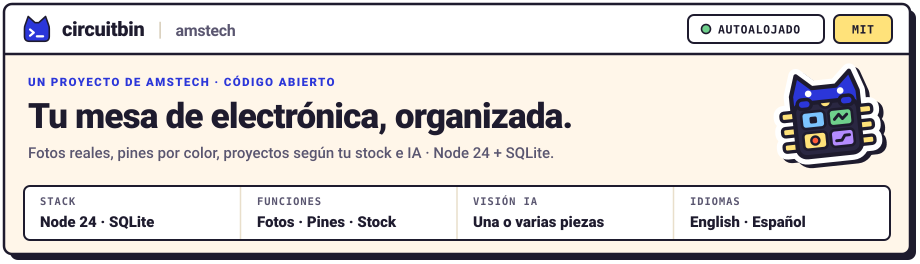
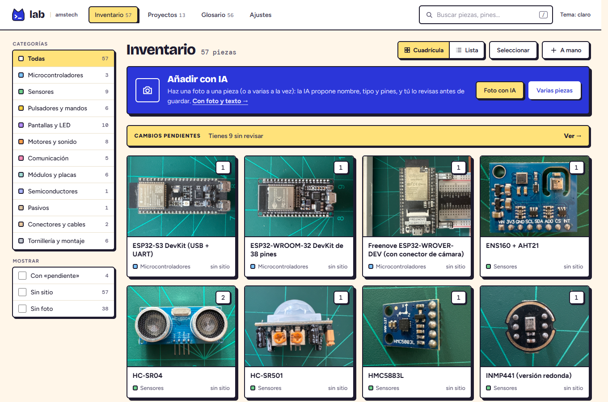
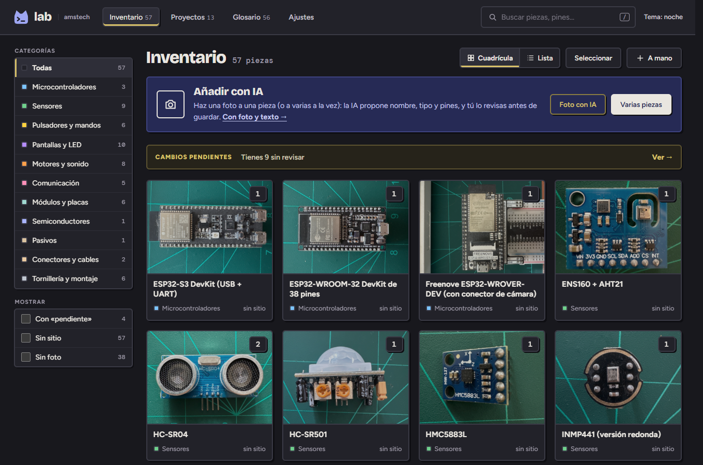
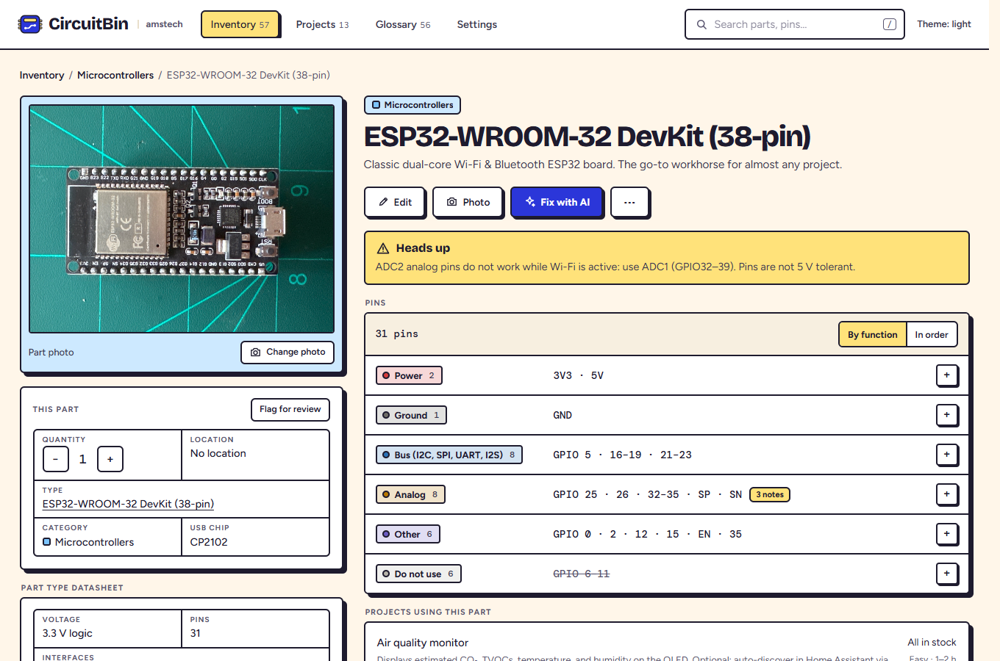
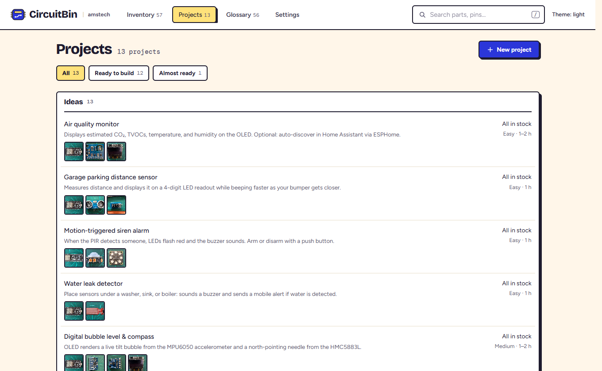
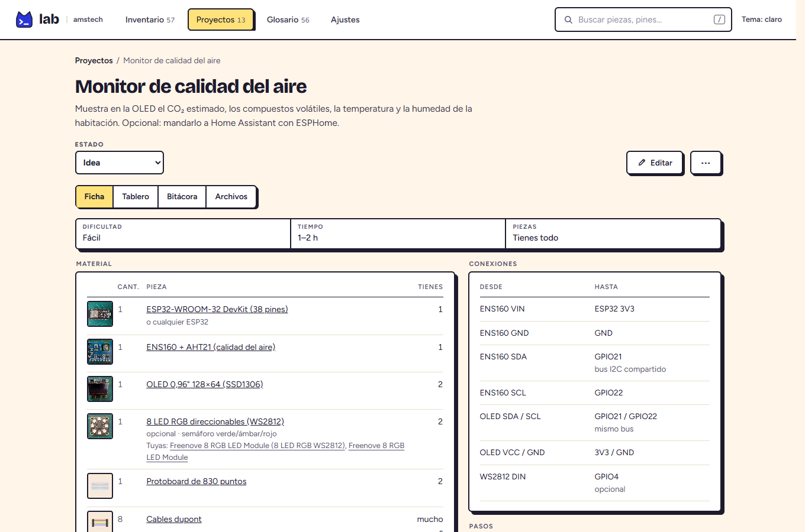
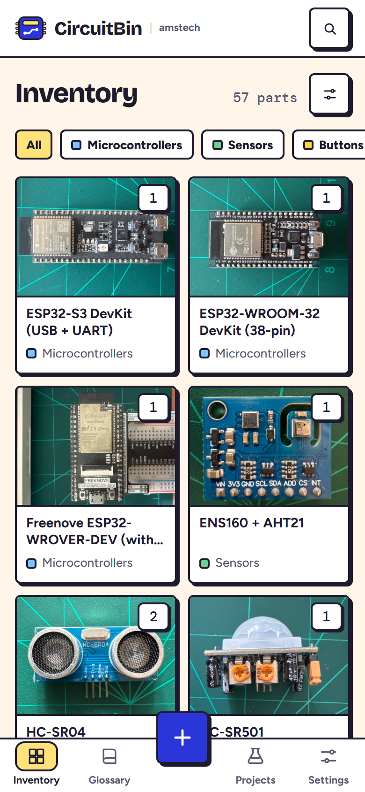
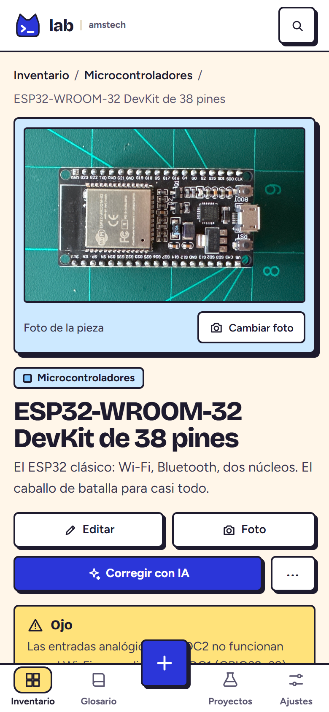
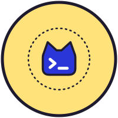

<p align="center">
  
</p>

<p align="center">
  
  
  
  
  
  
</p>

<p align="center">
  <a href="README.md">English</a> · <strong>Español</strong>
</p>

<p align="center">
  <a href="#características">Características</a> ·
  <a href="#capturas">Capturas</a> ·
  <a href="#arranque-rápido">Arranque rápido</a> ·
  <a href="#añadir-e-identificar-con-ia">Identificación con IA</a> ·
  <a href="#copias-y-modo-sin-conexión">Copias y sin conexión</a> ·
  <a href="#arquitectura">Arquitectura</a>
</p>

<p align="center">
  
  <br>
  <em>Vista principal en cuadrícula con fotos reales, filtros por categoría y acceso directo a la identificación con IA.</em>
</p>

---

## ¿Por qué CircuitBin?

**CircuitBin** (de **AMSTech**) es un almacén digital ligero y autoalojado de componentes electrónicos pensado para makers, cacharreo con Arduino/ESP32 y tu homelab.

Plataformas completas tipo ERP como InvenTree o Part-DB están diseñadas para compras industriales y gestión de almacenes. CircuitBin va directo a lo que importa en la mesa de trabajo: **saber exactamente qué módulos tienes en las cajas, consultar los pines al instante sin abrir PDFs y ver qué proyectos puedes montar hoy mismo con lo que ya tienes en stock.**

- **Cero frameworks en el navegador**: JavaScript y CSS sin compilación previa, sobre `node:http` y `node:sqlite`.
- **Un solo archivo SQLite**: todo el inventario, fichas, pines, proyectos e historial vive en `lab.db` junto a la carpeta `fotos/`.
- **Pensado para móvil y escritorio**: recorta fotos al momento en la mesa y úsalo instalado como PWA incluso sin cobertura.
- **Bilingüe inglés / español (`EN / ES`)**: interfaz y respuestas de la IA configurables en **Settings / Ajustes → Aspecto → Idioma**.

---

## Características

- **Inventario visual** — Vista en cuadrícula o lista, fotos reales de tus piezas, ubicaciones (`Sitios`), cantidades rápidas o marca `muchos` para pasivos y cables, selección múltiple y buscador instantáneo con `/` por nombre, pines, datos o notas.
- **Fichas con pines por función** — Cada tipo agrupa sus pines por colores (**Alimentación**, **Masa**, **Bus**, **Señal digital**, **Analógico**, **Otro** y **No usar** tachado para pines de flash o arranque) junto a avisos claros en caja amarilla (`Ojo`) sobre tensiones o conflictos de pines.
- **Proyectos conectados a tu stock** — Ideas iniciales y proyectos propios emparejados automáticamente con tu stock real (**Puedes hacerlo ahora** / **Te falta poco**), tabla de conexiones pin a pin, pasos, estado (`Idea` → `En marcha` → `Hecho`), tablero de tareas, bitácora con fotos y archivos adjuntos.
- **Asistente opcional con IA** — Haz una foto a una pieza suelta o hasta 40 módulos sobre la mesa: la IA identifica cada recorte, propone ficha, pines y dudas antes de guardar nada, o revisa fichas existentes mostrándote los cambios con vista previa.
- **Catálogo limpio** — Renombra categorías y sitios sobre la marcha, archiva o fusiona tipos duplicados y unifica unidades e interfaces (`3,3 V`, `20 mA`, `I2C`) sin gastar consultas de IA.
- **Modo claro y modo grafito** — Tema crema claro (`#FFF6E9`) y grafito oscuro (`#18181D`), automático según el sistema o con botón directo arriba.
- **Copias en 1 clic y PWA** — Exportación completa en `.tar.gz` (base de datos + fotos), copia diaria automática, instantáneas de seguridad antes de restaurar y caché sin conexión.

---

## Capturas

### Escritorio (modo claro y oscuro)

| Modo claro (Cuadrícula) | Modo noche (Grafito) |
| --- | --- |
|  |  |

### Ficha de componente y pines por color



### Proyectos conectados al stock y detalle de montaje

| Lista de proyectos (`Listos con tu stock`) | Detalle de proyecto (Materiales, conexiones y pasos) |
| --- | --- |
|  |  |

### Móvil

| Inventario móvil | Ficha móvil |
| --- | --- |
|  |  |

---

## Arranque rápido

### Docker Compose (Recomendado)

```bash
git clone https://github.com/msalexms/circuitbin.git
cd circuitbin
docker compose up -d
```

Abre **`http://localhost:4321`** (la base de datos y las fotos se guardan en `./data`).

### Node.js 24+ en local

CircuitBin usa el módulo nativo `node:sqlite` incluido en Node 24, sin dependencias nativas externas:

```bash
git clone https://github.com/msalexms/circuitbin.git
cd circuitbin
npm install
npm start
```

> [!IMPORTANT]
> **Seguridad y red:** CircuitBin no incluye cuentas de usuario ni inicio de sesión. Ejecútalo siempre en tu red local, tras WireGuard/Tailscale o detrás de un proxy inverso con autenticación — nunca expongas el puerto `4321` directamente a Internet.

### Variables de entorno

| Variable | Alias compatible | Por defecto | Descripción |
| --- | --- | --- | --- |
| `PORT` | — | `4321` | Puerto HTTP del servidor |
| `CIRCUITBIN_DATA` | `AMS_LAB_DATA` | `./data` (`/data` en Docker) | Carpeta para `lab.db` y `fotos/` |
| `CIRCUITBIN_COPIAS` | `AMS_LAB_COPIAS` | `<DATA>/copias` | Carpeta para copias diarias de SQLite |
| `CIRCUITBIN_COPIAS_MAX` | `AMS_LAB_COPIAS_MAX` | `14` | Número de copias diarias a conservar (`0` desactiva copias automáticas) |
| `IA_CLAVE` | — | *(opcional)* | Clave de OpenCode Go al arrancar |
| `IA_MODELO` | — | *(automático)* | Identificador inicial del modelo de IA |

*Todas las variables heredadas `AMS_LAB_*` y la imagen `ghcr.io/msalexms/ams-lab` siguen siendo 100 % compatibles.*

---

## Añadir e identificar con IA

La IA es **totalmente opcional** — la aplicación funciona al 100 % sin clave ni conexión externa. Al configurar una clave de suscripción de [OpenCode Go](https://opencode.ai) en **Ajustes → IA**:

1. **Foto con IA** — Haz una foto desde el móvil o sube una imagen; la app la recorta en cuadrado en local y propone nombre, tipo, tensiones, interfaces, pines, advertencias y dudas si algún texto de la placa no se lee bien.
2. **Varias piezas a la vez** — Pon hasta 40 módulos separados en la mesa y haz una foto general: la IA localiza cada pieza, eliges cuáles dar de alta y analiza cada recorte por separado antes de guardar nada.
3. **Corregir con IA** — Pide mejoras sobre cualquier ficha o componente existente y decide qué cambios aplicar con la pestaña **Vista previa**.
4. **Mismo idioma** — Las respuestas de la IA coinciden automáticamente con el idioma elegido en CircuitBin (**Inglés** o **Español**).

---

## Copias y modo sin conexión

- **Exportar y restaurar `.tar.gz`** — Descarga un archivo único con `lab.db` y todas tus fotos desde **Ajustes → Copias de seguridad**. Al subir una copia se inspecciona su contenido antes de restaurar y se guarda automáticamente una copia previa en el servidor.
- **Copia diaria automática** — Una vez al día realiza una copia consistente `VACUUM INTO` de SQLite y respalda de forma incremental las fotos nuevas.
- **Modo sin conexión (PWA)** — Un Service Worker ligero (`sw.js`) guarda la interfaz y la última snapshot de `/api/datos` para consultar piezas y pines aunque pierdas cobertura en el taller.

---

## Arquitectura

| Capa | Detalle |
| --- | --- |
| **Servidor y BD** | Node.js 24+ (`node:http`, `node:sqlite`, `node:crypto`, `node:zlib`) sin Express ni ORM |
| **Interfaz** | HTML + CSS + módulos ES sin compilar (`public/js/*.js`, `public/i18n.js`, `public/style.css`, `public/sw.js`) |
| **IA** | Vercel AI SDK (`ai`, `@ai-sdk/openai-compatible`, `zod`) con confirmación explícita antes de escribir |
| **Esquema SQLite** | Modelo versionado (`v9`) documentado en [docs/modelo-datos.md](docs/modelo-datos.md) |
| **Identidad visual** | Pegatina vectorial Thor Chip-Bin en [docs/logo/circuitbin.svg](docs/logo/circuitbin.svg) y banner en [docs/brand/banner.es.svg](docs/brand/banner.es.svg) ([CLAUDE.md](CLAUDE.md)) |

---

## Licencia

Distribuido bajo licencia [MIT](LICENSE).

<p align="center">
  <picture>
    <source media="(prefers-color-scheme: dark)" srcset="public/amstech-ui/logo/sello-noche.svg">
    
  </picture>
</p>
