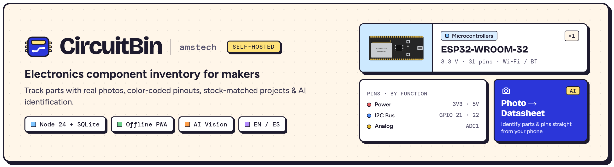
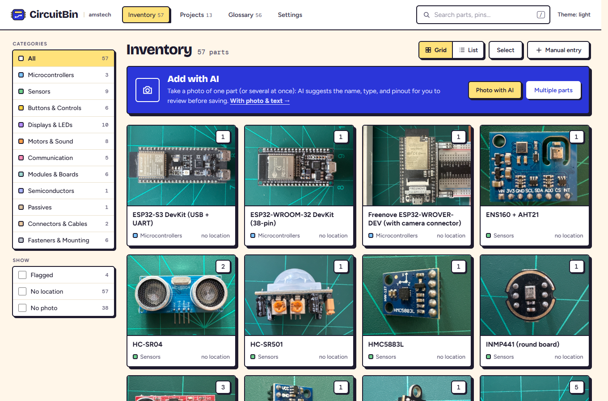
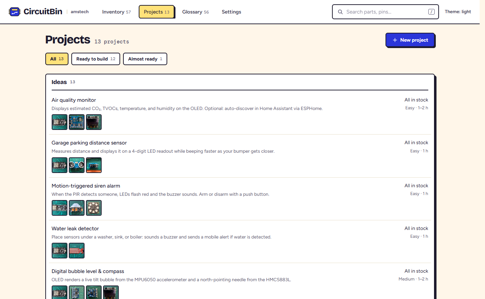
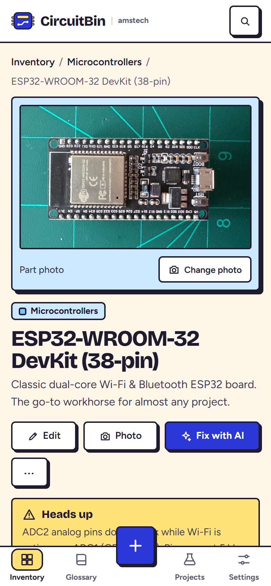

<p align="center">
  
</p>

<p align="center">
  
  
  
  
  
  
</p>

<p align="center">
  <strong>English</strong> · <a href="README.es.md">Español</a>
</p>

<p align="center">
  <a href="#features">Features</a> ·
  <a href="#screenshots">Screenshots</a> ·
  <a href="#quick-start">Quick Start</a> ·
  <a href="#ai-part-identification">AI Identification</a> ·
  <a href="#backups--offline-pwa">Backups &amp; Offline</a> ·
  <a href="#architecture">Architecture</a>
</p>

<p align="center">
  
  <br>
  <em>Grid inventory view with real component photos, color-coded category filters, and optional AI photo identification.</em>
</p>

---

## Why CircuitBin?

**CircuitBin** (by **AMSTech**) is a lightweight, self-hosted digital parts organizer for makers, electronics hobbyists, Arduino/ESP32 builders, and homelabs.

Full BOM/ERP platforms such as InvenTree or Part-DB are built for manufacturing procurement and warehouse teams. CircuitBin focuses on what matters on a soldering bench: **remembering which modules are sitting in your organizer bins, checking pinouts without digging through PDF datasheets, and discovering which projects you can build right now from parts already in stock.**

- **Zero frontend frameworks**: vanilla ES modules, single CSS stylesheet, and native `node:http` + `node:sqlite`.
- **Single-file SQLite database**: backups and migrations fit cleanly in one file alongside your part photos.
- **Built for phone & desktop**: snap a photo directly on the bench with square cropping and offline PWA caching.
- **Bilingual UI & AI (`EN / ES`)**: defaults to English and switches between **English** and **Español** at any time in **Settings → Appearance → Language**.

---

## Features

- **Visual Part Inventory** — Grid or list view, real component photos, storage bin locations (`Location`), custom quantities (or `many` for bulk resistors/jumpers), `Flagged` reminders, bulk multi-select actions, and instant keyboard search (`/` across part names, pins, specs, and notes).
- **Color-Coded Interactive Pinouts** — Dedicated datasheet per component type grouped by function (**Power**, **Ground**, **Bus**, **Digital**, **Analog**, **Other**, **Do not use** — struck through for strapping/flash pins) plus prominent **Heads up** electrical warnings (e.g., 3.3 V logic tolerance, ADC2/Wi-Fi conflicts).
- **Stock-Matched Projects** — Pre-seeded starter builds and custom projects automatically cross-checked against your live inventory (`Ready to build` vs `Almost ready`), complete with wiring tables, step-by-step instructions, status tracking (`Idea` → `Building` → `Done`), Kanban task board, build log, and schematic attachments.
- **Optional AI Vision Identification** — Snap one board or photograph up to 40 loose parts on your bench; AI proposes names, types, specs, pinouts, and clarifying questions before saving a single byte, or audits existing datasheets with a live diff preview.
- **Data Hygiene & Normalization** — Inline renaming, category ordering, safe type merging, unused-type archiving, and one-click formatting standardization (`3.3 V`, `20 mA`, `I2C`) at zero AI cost.
- **Day & Graphite Themes** — Warm cream light mode (`#FFF6E9`) and soft graphite dark mode (`#18181D`), synced to system preference or toggled in the header.
- **Offline PWA & 1-Click Backups** — Installable progressive web app with offline browse cache, scheduled daily SQLite snapshots, full `.tar.gz` archive export/restore (DB + photos), pre-restore safety snapshots, and read-only JSON export.

---

## Screenshots

### Desktop Light & Dark Modes

| Light mode (Inventory Grid) | Dark mode (Graphite) |
| --- | --- |
|  |  |

### Component Datasheet & Color-Coded Pinout


### Stock-Matched Projects & Build Guide

| Projects List (`Ready to build`) | Project Details (BOM, Wiring & Steps) |
| --- | --- |
|  |  |

### Mobile Workbench View

| Mobile Inventory | Mobile Datasheet |
| --- | --- |
|  |  |

---

## Quick Start

### Docker Compose (Recommended)

```bash
git clone https://github.com/msalexms/circuitbin.git
cd circuitbin
docker compose up -d
```

Open **`http://localhost:4321`** (database and photos persist under `./data`).

### Local Node.js 24+

CircuitBin uses Node 24's built-in `node:sqlite` module — no native compilation needed:

```bash
git clone https://github.com/msalexms/circuitbin.git
cd circuitbin
npm install
npm start
```

> [!IMPORTANT]
> **Security & Network Exposure:** CircuitBin has no user accounts or built-in authentication. Run it inside your private LAN, over WireGuard/Tailscale, or behind an authenticated reverse proxy — never expose port `4321` directly to the public internet.

### Environment Variables

| Variable | Legacy Alias | Default | Description |
| --- | --- | --- | --- |
| `PORT` | — | `4321` | HTTP server port |
| `CIRCUITBIN_DATA` | `AMS_LAB_DATA` | `./data` (`/data` in Docker) | Directory for `lab.db` and `fotos/` |
| `CIRCUITBIN_COPIAS` | `AMS_LAB_COPIAS` | `<DATA>/copias` | Directory for automatic daily SQLite backups |
| `CIRCUITBIN_COPIAS_MAX` | `AMS_LAB_COPIAS_MAX` | `14` | Daily backups to retain (`0` disables auto-backups) |
| `IA_CLAVE` | — | *(optional)* | Pre-configure OpenCode Go API key at startup |
| `IA_MODELO` | — | *(auto)* | Initial AI model identifier |

*All legacy `AMS_LAB_*` environment variables and `ghcr.io/msalexms/ams-lab` container upgrades remain 100% compatible.*

---

## AI Part Identification

AI assistance is **100% optional** — CircuitBin works completely offline without any API key. When configured via **Settings → AI (Model & API key)** with an [OpenCode Go](https://opencode.ai) subscription key:

1. **Photo with AI** — Snap a component from phone or desktop. CircuitBin crops to a square locally and extracts part name, category, voltage specs, interfaces, pinout functions, electrical warnings, and follow-up questions if board silkscreen is ambiguous.
2. **Batch Detection (`Multiple parts`)** — Place up to 40 loose boards or sensors on a clean background and upload one overview photo. CircuitBin locates bounding boxes, lets you check what to keep, crops each item locally, and identifies them in parallel.
3. **Audit Existing Datasheets (`Fix with AI`)** — Review or fix an existing component or datasheet using new photos or a short text prompt; inspect every proposed change side by side with a live **Preview** tab before applying anything.
4. **Matched Language** — AI prompts automatically respond in your selected CircuitBin language (**English** or **Español**).

---

## Backups & Offline PWA

- **Full `.tar.gz` Export & Restore** — Download a single archive with `lab.db` and all part photos from **Settings → Data & backups**. Uploading an archive or `.db` inspects counts and schema version before applying, and automatically takes a `pre-restore` snapshot first.
- **Automated Daily Snapshots** — Once per day, CircuitBin writes an atomic `VACUUM INTO` copy of SQLite plus incremental backups of new photos.
- **Offline Read Mode** — A lightweight Service Worker (`sw.js`) caches the app shell and latest `/api/datos` snapshot so you can still look up pinouts and parts while standing at a workshop bench with poor Wi-Fi.

---

## Architecture

| Layer | Implementation |
| --- | --- |
| **Runtime & DB** | Node.js 24+ (`node:http`, `node:sqlite`, `node:crypto`, `node:zlib`) — zero Express or ORM dependencies |
| **Frontend** | Vanilla ES6 UI (`public/app.js`, `public/i18n.js`, `public/style.css`, Service Worker `public/sw.js`) |
| **AI Integration** | Vercel AI SDK (`ai`, `@ai-sdk/openai-compatible`, `zod`) behind an explicit user confirmation workflow |
| **Schema** | Versioned SQLite (`v9`) documented in [docs/modelo-datos.md](docs/modelo-datos.md) |
| **Brand Assets** | Custom SVG emblem in [docs/logo/circuitbin.svg](docs/logo/circuitbin.svg) & AMSTech tokens in [CLAUDE.md](CLAUDE.md) |

---

## License

Released under the [MIT License](LICENSE).

<p align="center">
  
</p>
