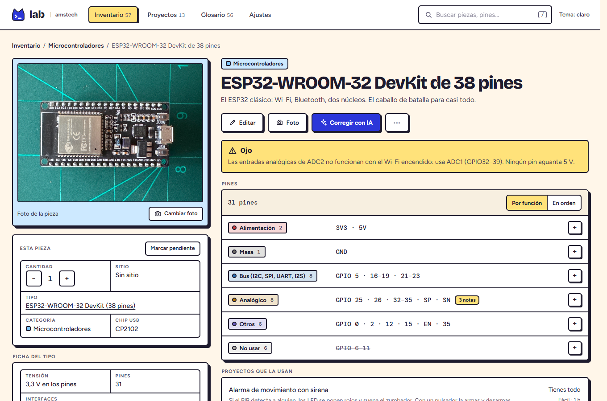
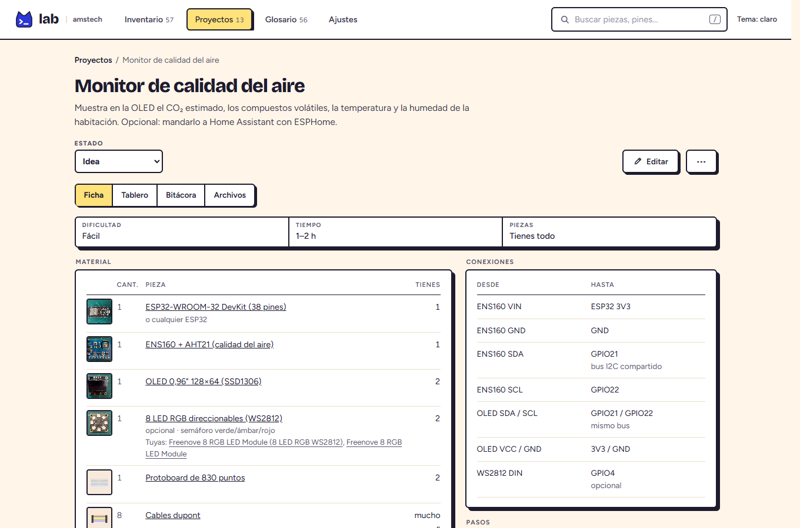
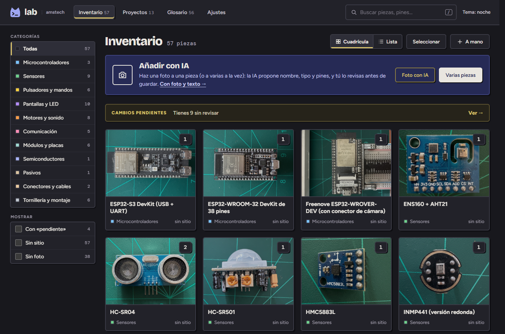
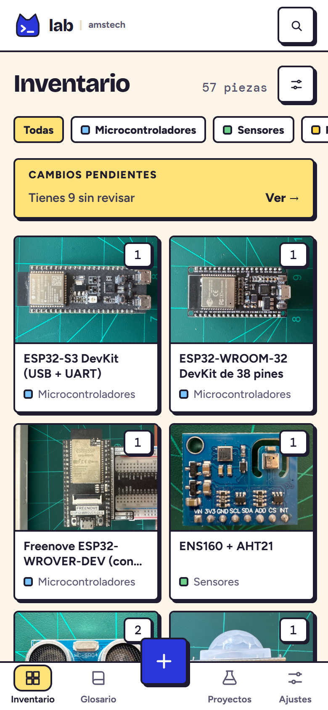
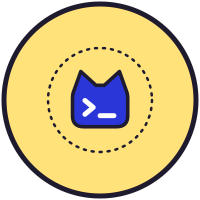

<div align="center">

<picture>
  <source media="(prefers-color-scheme: dark)" srcset="public/amstech-ui/logo/thor-noche.svg">
  <source media="(prefers-color-scheme: light)" srcset="public/amstech-ui/logo/thor.svg">
  
</picture>

<h1>[AMS] lab</h1>

<p><strong>Almacén digital de componentes electrónicos para tu homelab</strong><br>
Inventario con fotos reales, fichas de pines, proyectos conectados a tu stock e identificación con IA.</p>

<p>
  =24" src="https://img.shields.io/badge/Node.js-%E2%89%A524-2B36D9?style=flat-square&logo=nodedotjs&logoColor=white">
  
  
  
  <a href="LICENSE"></a>
</p>

<p>
  <a href="#características">Características</a> ·
  <a href="#capturas">Capturas</a> ·
  <a href="#arranque-rápido">Arranque rápido</a> ·
  <a href="#añadir-con-ia">Añadir con IA</a> ·
  <a href="#copias-de-seguridad-y-modo-sin-conexión">Copias y sin conexión</a> ·
  <a href="#arquitectura">Arquitectura</a>
</p>

<br>

<picture>
  <source media="(prefers-color-scheme: dark)" srcset="docs/capturas/inventario-noche.png">
  <source media="(prefers-color-scheme: light)" srcset="docs/capturas/inventario-claro.png">
  
</picture>

<p><em>Vista principal del inventario en cuadrícula con fotos reales, filtros laterales por categoría y acceso directo al asistente con IA (se adapta al tema claro u oscuro de GitHub).</em></p>

</div>

---

## ¿Por qué [AMS] lab?

- **Directo al grano, sin infraestructura pesada**: un único servicio en **Node.js 24+** con **SQLite nativo (`node:sqlite`)** y frontend en HTML, CSS y JavaScript sin frameworks ni paso de compilación. Todo persiste en una sola carpeta `./data`.
- **Pieza física separada de su ficha técnica**: cada **pieza** guarda lo que tienes en tu taller (cantidad, sitio, foto real, notas y datos propios como el valor óhmico); la **ficha del tipo** vive en el Glosario y comparte pines, tensión, interfaces y avisos «Ojo» entre todas las piezas iguales.
- **IA opcional siempre bajo tu control**: fotografia una pieza o una bandeja con varias, el modelo propone nombre, tipo y pines, resuelve dudas con opciones rápidas y enseña diferencias antes/después; **nada entra en el inventario sin que tú lo confirmes**.
- **Pensado para el móvil y el homelab**: PWA instalable con modo sin conexión, tipografías locales (sin peticiones externas), estilo AMSTech claro/noche y copias de seguridad diarias automáticas.

---

## Características

| Área | Qué incluye |
| :--- | :--- |
| **Inventario** | Vista en **cuadrícula** (con tu foto real o el dibujo SVG del tipo sobre el color de su categoría) o **lista** alineada por sitio, tensión e interfaces. Filtros por categoría, piezas marcadas como «pendiente», sin sitio o sin foto. Búsqueda global instantánea (`/`). Selección múltiple para editar en lote, marcar pendiente, borrar (con «Deshacer» 2 min) o corregir con IA hasta 30 piezas. |
| **Fichas y pines** | Un pin por fila con función coloreada y nota adicional. En placas con más de 8 pines se agrupan por función en desplegables o se alternan en el orden de la placa. Editor manual con tablas reordenables arrastrando (`⠿`) y protección frente a ediciones simultáneas (`409`). |
| **Formato uniforme** | Normalización automática al guardar o al pasar por **Ajustes → Uniformar formato**: magnitudes (`3,3 V`, `20 mA`), rangos, interfaces (`I2C`) y nombres de datos consistentes sin tocar serigrafías ni textos libres. |
| **Proyectos** | Cruzados automáticamente con tu stock para ver qué proyectos **«Puedes hacer ya»** o en cuáles **«Te falta poco»**. Cada proyecto incluye lista de material con tus piezas y fotos, tabla de conexiones, pasos, **tablero Kanban** (`Por hacer`, `En curso`, `Hecho`), **bitácora** con fotos y repositorio de **archivos** (imágenes o PDF). |
| **Asistente con IA** | Tres flujos integrados: alta de una pieza (1–4 fotos y/o texto), detección de **varias piezas en una foto** con recorte en el navegador, y **Corregir con IA** sobre piezas o fichas existentes (individual o en lote) con vista previa y selección de cambios campo a campo. |
| **Trazabilidad y control** | Gestión de categorías, tipos (archivar, fusionar duplicados, borrar sin que el catálogo base los resucite) y sitios. **Historial de cambios** con el antes y el después de cada modificación (usuario, modelo de IA o sistema) y **Registro** del servidor en vivo. |

---

## Capturas

### Ficha de pieza y mapa de pines

Cada ficha reúne arriba lo que necesitas con la pieza en la mano —foto, cantidad, ubicación, tipo, avisos «Ojo» y pines agrupados por función— y deja debajo los proyectos que la utilizan y su historial.

<p align="center">
  
</p>

### Proyectos conectados a tu inventario

<table>
  <tr>
    <td width="50%" align="center">
      
      <br><sub><strong>Listado de proyectos</strong> · Filtra al instante por «Puedo hacerlo ya» o «Me falta poco» con las fotos de tus piezas.</sub>
    </td>
    <td width="50%" align="center">
      
      <br><sub><strong>Ficha de proyecto</strong> · Material cruzado con tu inventario, tabla de conexiones, pasos, tablero, bitácora y archivos.</sub>
    </td>
  </tr>
</table>

### Tema claro y tema noche

<table>
  <tr>
    <td width="50%" align="center">
      
      <br><sub><strong>Tema claro</strong> · Fondo crema, bordes en tinta y tarjetas de categoría.</sub>
    </td>
    <td width="50%" align="center">
      
      <br><sub><strong>Tema noche</strong> · Grafito suave pensado para trabajar en el taller sin deslumbrar.</sub>
    </td>
  </tr>
</table>

### Experiencia móvil (PWA)

Interfaz adaptada al pulgar con barra inferior, botón `+` directo para abrir la cámara con IA, encuadre 4:3 antes de subir la foto y consulta sin conexión.

<table align="center">
  <tr>
    <td align="center">
      
      <br><sub><strong>Inventario en móvil</strong> · Tira de categorías y barra inferior con acceso rápido a cámara IA.</sub>
    </td>
    <td align="center">
      
      <br><sub><strong>Ficha en móvil</strong> · Consulta rápida de avisos y pines junto a la protoboard.</sub>
    </td>
  </tr>
</table>

---

## Arranque rápido

### Con Docker Compose (homelab)

```sh
git clone https://github.com/msalexms/ams_lab.git
cd ams_lab
docker compose up -d --build
```

La aplicación queda escuchando en `http://<ip-del-servidor>:4321` (con endpoint de salud en `/salud`) y guarda la base de datos SQLite, las fotos y las copias diarias en `./data`.

### En local con Node.js 24+

```sh
git clone https://github.com/msalexms/ams_lab.git
cd ams_lab
npm ci
npm start
```

Abre `http://localhost:4321` en el ordenador o la dirección `móvil → http://<tu-ip>:4321` que imprime en consola desde la misma red Wi-Fi.

Al arrancar por primera vez con una carpeta de datos vacía se crea un catálogo básico con **14 categorías**, **18 tipos comunes con sus pines**, **4 proyectos de ejemplo** y **6 piezas `(ejemplo)`** listas para probar y borrar cuando añadas las tuyas.

> [!IMPORTANT]
> **[AMS] lab no incluye inicio de sesión ni contraseña por diseño.** Está pensada para ejecutarse exclusivamente en tu red local, dentro de una red privada (como Tailscale o WireGuard) o detrás de un proxy inverso con autenticación. No la expongas directamente a internet sin protección delante.

<details>
<summary>Despliegue sin Compose, compilación para ARM64 (Raspberry Pi) y variables de entorno</summary>

#### Contenedor Docker suelto

```sh
docker build -t ams-lab .
docker run -d --name ams-lab --init -p 4321:4321 -v ./data:/data ams-lab
```

#### Raspberry Pi / servidores ARM64

```sh
docker buildx build --platform linux/arm64 -t ams-lab .
```

El contenedor se ejecuta como usuario `node` (UID 1000); el script de entrada ajusta los permisos de `/data` al arrancar.

#### Variables de entorno

| Variable | Por defecto | Descripción |
| :--- | :--- | :--- |
| `PORT` | `4321` | Puerto HTTP del servidor. |
| `TZ` | `Europe/Madrid` | Zona horaria usada en fechas de copias e historial. |
| `AMS_LAB_DATA` | `./data` (`/data` en Docker) | Carpeta donde viven `lab.db`, `fotos/` y `copias/`. |
| `AMS_LAB_COPIAS` | `<datos>/copias` | Carpeta alternativa para copias diarias (útil en otro disco). |
| `AMS_LAB_COPIAS_MAX` | `14` | Número máximo de copias diarias conservadas (`0` las desactiva). |
| `IA_CLAVE` | — | Clave de respaldo para OpenCode Go si no hay ninguna guardada en la web. |
| `IA_MODELO` | — | Modelo de respaldo si no se ha configurado desde la web. |

</details>

---

## Añadir con IA

La IA es **totalmente opcional**: toda la aplicación funciona al 100 % de forma manual. Si quieres activarla, la configuración se hace directamente desde la web en **Añadir con IA → Configuración** (o **Ajustes → IA**):

- **Proveedor y modelos**: conectada a **OpenCode Go** mediante el AI SDK. La aplicación consulta los modelos disponibles e indica cuáles soportan **visión**, **salida estructurada** y su **coste estimado por consulta**, además de permitir elegir el nivel de razonamiento (`poco`, `medio` o `mucho`).
- **Privacidad de la clave**: la clave se valida con una llamada mínima al guardarla, se almacena en SQLite (viaja en tus copias completas) y **nunca se devuelve por la API**; la interfaz solo muestra los últimos 4 caracteres. Como respaldo en local también puedes usar `.env` partiendo de [`.env.example`](.env.example).
- **Tres flujos sin sorpresas**:
  1. **Foto con IA**: sube de 1 a 4 fotos (con recorte 4:3 opcional en el navegador) y/o texto; el modelo devuelve una propuesta editable con vista previa y puede plantear preguntas con opciones rápidas y foto por duda (hasta 5 rondas).
  2. **Varias piezas en una foto**: detecta las piezas sobre la mesa, tú eliges cuáles te interesan, el navegador las recorta localmente y crea un lote para revisarlas juntas.
  3. **Corregir con IA**: disponible en cada pieza, cada ficha o en lote (hasta 30 piezas); muestra un diff campo a campo con lo anterior tachado y te deja marcar exactamente qué aplicar.
- **Cola persistente**: todas las tareas se guardan en `ia_tareas`. Si cierras la pestaña mientras el modelo piensa, el resultado te espera en **Cambios pendientes**.

---

## Copias de seguridad y modo sin conexión

### Copias de seguridad

- **Automáticas diarias**: al arrancar y en comprobaciones horarias, el servidor genera `lab-AAAA-MM-DD.db` mediante `VACUUM INTO` (consistente con SQLite en modo WAL) y copia las fotos nuevas a `copias/fotos/`. También puedes lanzar una al instante con `npm run copia` o desde **Ajustes → Datos**.
- **Exportación y restauración completas**: desde **Ajustes → Datos** puedes descargar un archivo `.tar.gz` con `lab.db`, todas las fotos y `manifiesto.json`. Al restaurar un `.tar.gz`, un `.db` o una copia del servidor, primero se valida su integridad y se muestra una comparativa; al confirmar, guarda automáticamente `lab-antes-restaurar-<fecha>.db` antes de aplicar el cambio y sin necesidad de reiniciar.

### Modo sin conexión (PWA)

El Service Worker ([`public/sw.js`](public/sw.js)) guarda en el dispositivo la última copia del inventario, glosario, proyectos, tipografías y las fotos que ya hayas abierto para consultar tu taller sin cobertura (en modo solo lectura hasta recuperar la red).

Los navegadores requieren **HTTPS** (o `localhost`) para habilitar el Service Worker y la instalación como app. Con Tailscale en tu servidor basta un comando:

```sh
tailscale serve --bg 4321
```

Después abre esa dirección HTTPS en el móvil y usa **Añadir a pantalla de inicio**.

---

## Arquitectura

| Capa | Tecnología |
| :--- | :--- |
| **Servidor** | Node.js ≥ 24 (`node:http`, sin frameworks web) |
| **Base de datos** | SQLite integrado (`node:sqlite`, modo WAL, migraciones automáticas `PRAGMA user_version`) |
| **Frontend** | HTML + CSS + Vanilla JS (`public/app.js`, Service Worker PWA, sistema visual `amstech-ui`) |
| **IA (opcional)** | `ai`, `@ai-sdk/openai-compatible`, `@ai-sdk/anthropic`, `@ai-sdk/openai`, `zod` |
| **Despliegue** | Imagen `node:24-alpine` sin privilegios (`node`), healthcheck en `/salud`, volumen único `/data` |

```text
ams_lab/
├─ server/          # API HTTP, SQLite y migraciones, copias, respaldo tar.gz, IA, auditoría y formato
├─ public/          # Web SPA, Service Worker, dibujos SVG de componentes y paquete amstech-ui/
├─ seed/            # Referencia inicial (categorías, pines) y catálogo base (tipos, proyectos, ejemplos)
├─ scripts/         # Utilidades CLI (copia manual, regeneración de SVG, pines, servidor IA simulado)
└─ docs/            # Esquema de base de datos (modelo-datos.md) y capturas reales
```

Para profundizar en el esquema de tablas, migraciones y reglas de negocio consulta [`docs/modelo-datos.md`](docs/modelo-datos.md).

<details>
<summary>Scripts disponibles en package.json</summary>

| Comando | Qué hace |
| :--- | :--- |
| `npm start` | Inicia el servidor en producción cargando `.env` si existe. |
| `npm run dev` | Inicia el servidor en modo `--watch-path=server`. |
| `npm run copia` | Ejecuta inmediatamente una copia diaria en `data/copias/` (o `AMS_LAB_COPIAS`). |
| `npm run catalogo` | Aplica los cambios de `seed/` a la base de datos respetando lo editado por usuario o IA. |
| `npm run pines` | Regenera definiciones de pines y actualiza el catálogo base. |
| `npm run dibujos` | Regenera los SVG propios de cada tipo en `public/img/tipos/`. |
| `npm run ia-simulada` | Levanta un servidor OpenCode Go simulado para probar flujos de IA sin consumir cuota. |

</details>

---

## Licencia

Distribuido bajo la [licencia MIT](LICENSE). Las tipografías incluidas (`Bricolage Grotesque`, `Figtree` y `DM Mono` en `public/amstech-ui/fuentes/`) conservan sus respectivas licencias SIL Open Font License 1.1.

<div align="center">

<br>

<picture>
  <source media="(prefers-color-scheme: dark)" srcset="public/amstech-ui/logo/sello-noche.svg">
  <source media="(prefers-color-scheme: light)" srcset="public/amstech-ui/logo/sello.svg">
  
</picture>

<p><strong>Un proyecto de AMSTech</strong> · <em>Hecho para mí, compartido con todos</em> · Código abierto · MIT</p>

</div>
